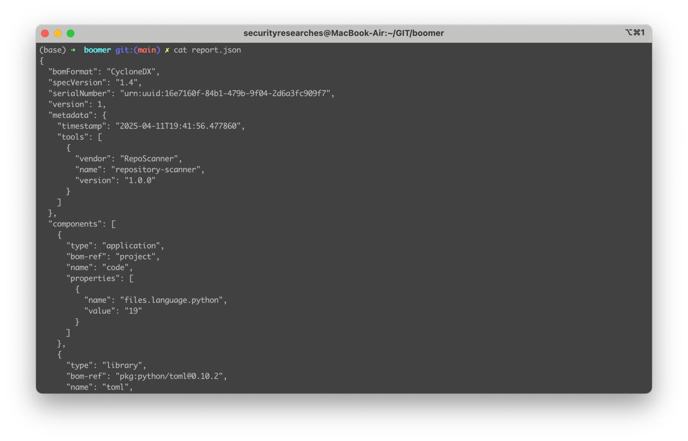

🚗 Boomer



Boomer is like your old car — easy to drive, and a joy every time.

It’s a universal SBOM (Software Bill of Materials) generator that lists all your project dependencies in a single, clean JSON. No need to specify the language — Boomer automatically detects it and uses the appropriate parser to gather the libraries.

🔍 No configuration.

🧠 No guesswork.

📦 Just one command and you get your full dependency list.

And the best part? We didn’t reinvent the wheel.

Boomer outputs in CycloneDX — the industry-standard format for BOM files.

## Supported package manifests

| Language | Package manager / format | Dependency file | Lockfile |
| --- | --- | --- | :---: |
| Python | pip | `requirements.txt` | No |
| Python | Pipenv | `Pipfile` | No |
| Python | Pipenv | `Pipfile.lock` | Yes |
| Python | Poetry / PEP 621 | `pyproject.toml`, `poetry.lock` | Yes (`--prefer-locks`) |
| Python | setuptools | `setup.py` | No |
| JavaScript | npm | `package.json` | No |
| JavaScript | npm | `package-lock.json` | Yes (`--prefer-locks`) |
| JavaScript | Yarn | `yarn.lock` | Yes (`--prefer-locks`) |
| Java | Maven | `pom.xml`, `lockfile.json` | Yes (`--prefer-locks`) |
| Java | Gradle | `build.gradle`, `build.gradle.kts` | No |
| C++ | CMake | `CMakeLists.txt` | No |
| C++ | Conan | `conanfile.txt` | No |
| C++ | vcpkg | `vcpkg.json` | No |
| C# | NuGet / MSBuild | `*.csproj`, `packages.config`, `*.sln` | No |
| Go | Go modules | `go.mod` | No |
| Go | Go modules | `go.sum` | No (checksums) |
| Go | dep | `Gopkg.toml` | No |
| Go | dep | `Gopkg.lock` | Yes |
| Rust | Cargo | `Cargo.toml` | No |
| Rust | Cargo | `Cargo.lock` | Yes |
| PHP | Composer | `composer.json` | No |
| PHP | Composer | `composer.lock` | Yes (`--prefer-locks`) |
| Ruby | Bundler | `Gemfile` | No |
| Ruby | Bundler | `Gemfile.lock` | Yes |

## Tests

Run the Python, JavaScript, and Go scanner fixtures with:

```bash
make test-parsers
```

To generate fixture BOMs for manual inspection, run:

```bash
make scan-fixtures
```

The reports are written to `tests/reports/`.

```
docker run -it --rm -v $(pwd):/code whitespots/boomer:latest boomer scan /code -o /code/report.json
```

# Plans

- ASCII style BMW e38
